<p align="center">
  
</p>

<h1 align="center">xpando</h1>

<p align="center"><em>A text expander with a real app. Built on <a href="https://github.com/espanso/espanso">espanso</a>.</em></p>

<p align="center">
  
  
  
</p>

<p align="center">
  <a href="https://github.com/ultimatejimmy/xpando/releases/latest"><b>Download</b></a> &nbsp;·&nbsp;
  <a href="https://ultimatejimmy.github.io/xpando/">Website</a> &nbsp;·&nbsp;
  <a href="https://github.com/ultimatejimmy/xpando/wiki">Wiki</a>
</p>

<p align="center">
  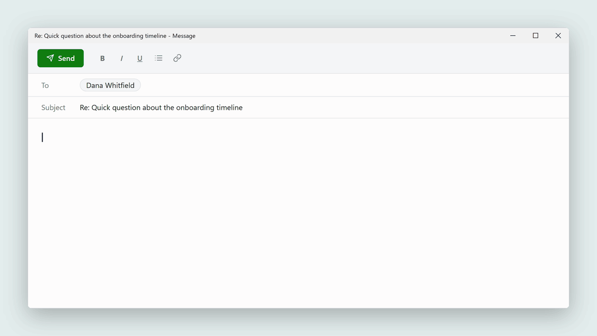
</p>

xpando is a fork of espanso with a modern desktop app for managing your phrases,
in the spirit of tools like PhraseExpress. Your phrases stay in plain YAML files,
so espanso's features keep working, but you no longer have to hand-edit them.

> **Status:** early development. Windows is the primary target. macOS and Linux
> are kept building in CI but get less testing. Expect rough edges, and keep
> backups of your `match` folder (xpando also writes a one-time `.yml.bak` the
> first time it edits a file).

<p align="center">
  <picture>
    <source media="(prefers-color-scheme: dark)" srcset="site/assets/img/library.dark.png">
    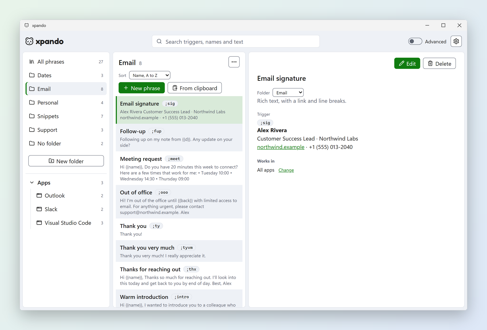
  </picture>
</p>

## What you get

* **Phrase manager.** Browse, search and edit every phrase in a three-pane window.
  Search understands operators, and conflicting triggers are flagged.
* **Rich text.** A full WYSIWYG editor for formatted phrases (bold, lists, links,
  tables), stored as espanso `html:` matches.
* **Macros.** Insert the date, the clipboard, a random pick, a choice list and
  more, with a simple editor. Power options (shell commands, forms) are in
  Advanced mode.
* **Folders and per-app scope.** Each folder is a match file. Limit a folder to
  chosen apps, or leave it for everything.
* **Advanced mode.** One switch reveals the power tools: every match option,
  the macro settings, and an editable YAML view with a safety net.
* **Safe edits.** Saves are atomic, preserve your comments and formatting, and
  refuse if the file changed underneath you.
* **Set clipboard.** A native `set_clipboard` macro for xpando's engine, instead
  of PowerShell workarounds. Stock espanso does not understand it. See
  [docs/xpando/SET-CLIPBOARD.md](docs/xpando/SET-CLIPBOARD.md).
* **Built on espanso's engine.** Triggers, regex and app-specific configs keep working.
  xpando's engine is its own build of espanso's: mostly the same, with additions that stock
  espanso does not have. See the [espanso docs](https://espanso.org/docs/) for the shared parts.

## A quick tour

**Make a phrase in seconds.** Pick a trigger, write the text and drop in a macro such as today's date.

<p align="center">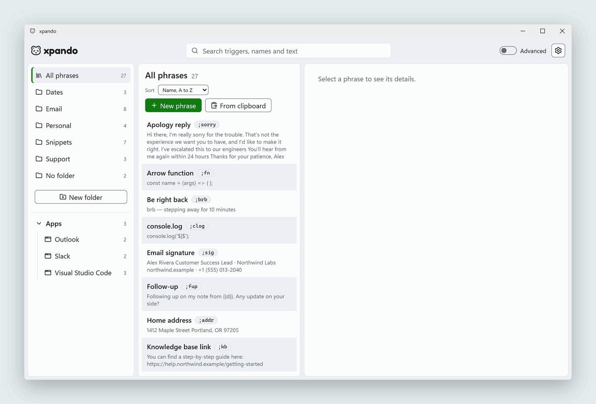</p>

**Search from any app.** Press Alt+Space anywhere, type a few letters and press Enter: xpando types the phrase where you were.

<p align="center">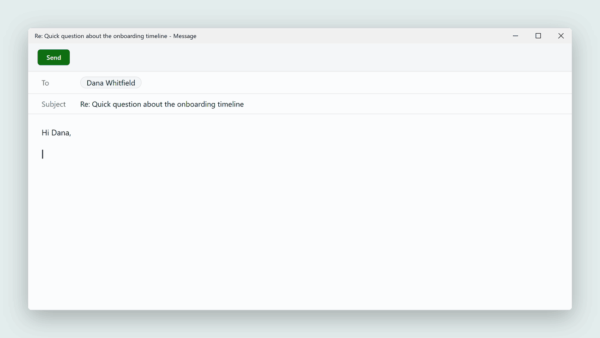</p>

**Find anything as you type.** Search looks through triggers, names and the text itself.

<p align="center">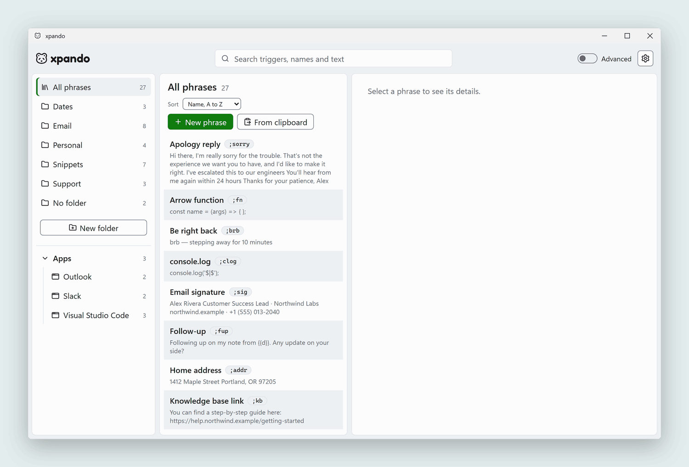</p>

**Rich text, like a document.** Bold, lists, links and tables with a familiar toolbar.

<p align="center">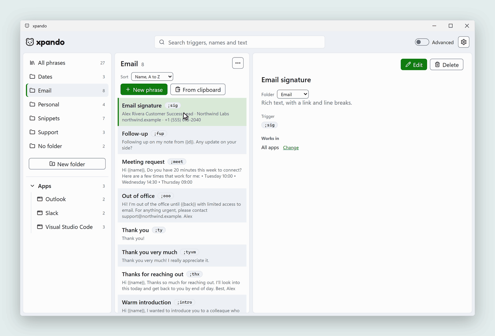</p>

**Macros fill in the details.** Dates in any format, the clipboard, a random pick, a choice list and more.

<p align="center">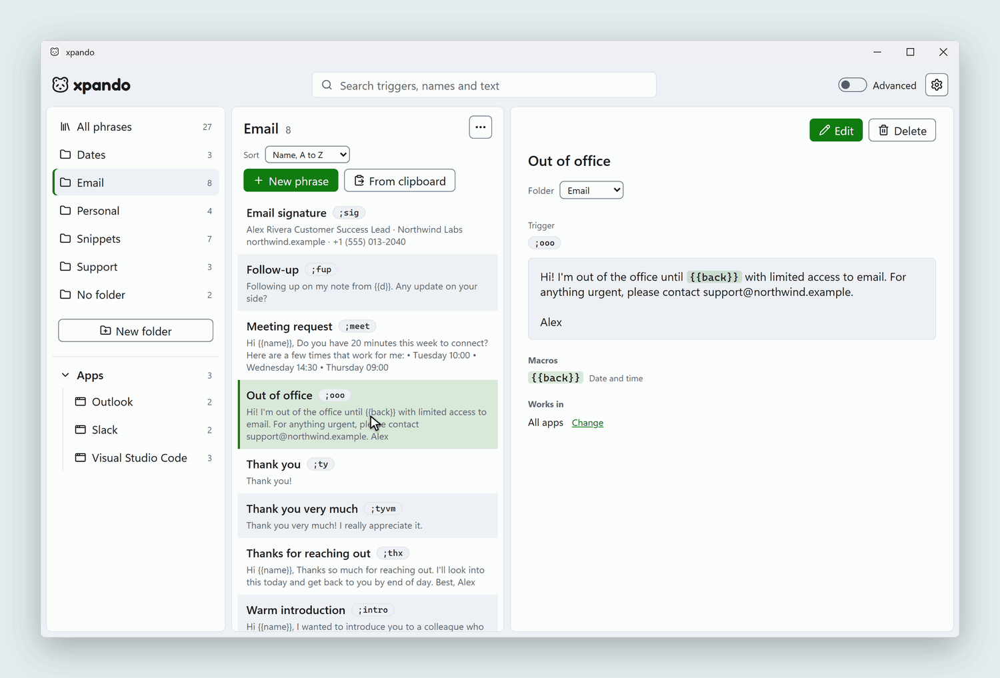</p>

**The right phrase in the right app.** Limit a phrase to the programs you choose.

<p align="center">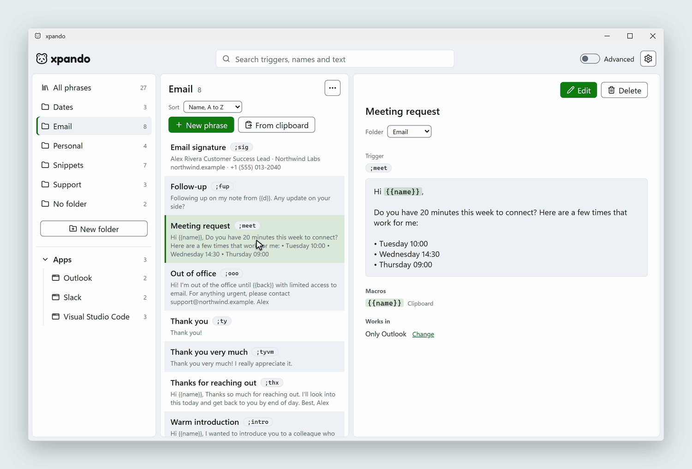</p>

**Power tools, one switch away.** Advanced mode adds the YAML view, every match option and the trigger conflicts panel.

<p align="center">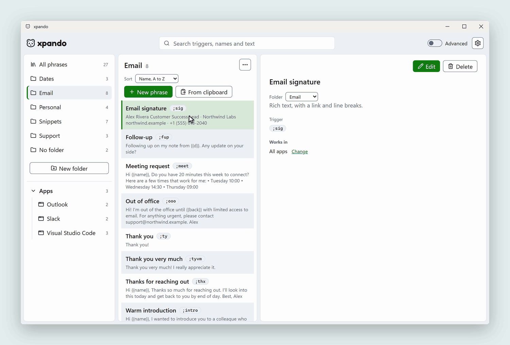</p>

<details>
<summary>More screenshots</summary>

<p align="center">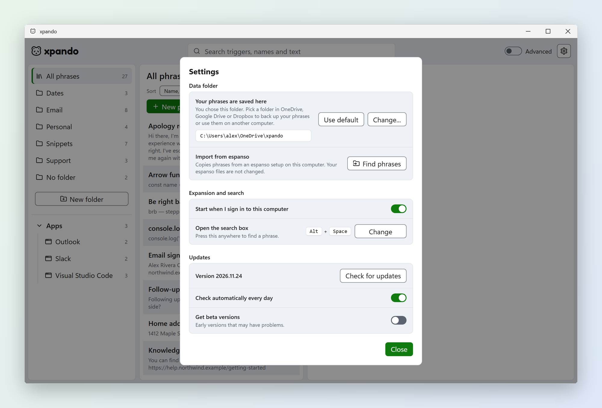</p>
<p align="center">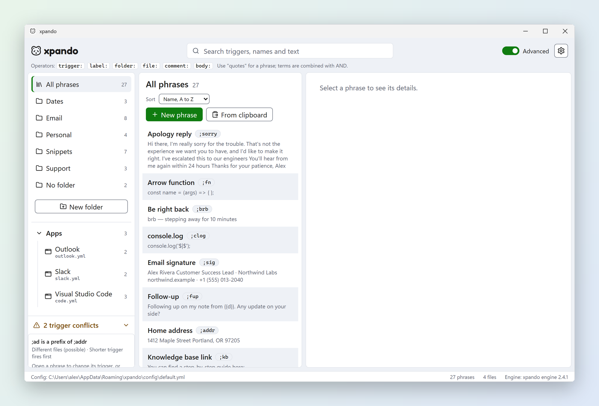</p>
<p align="center">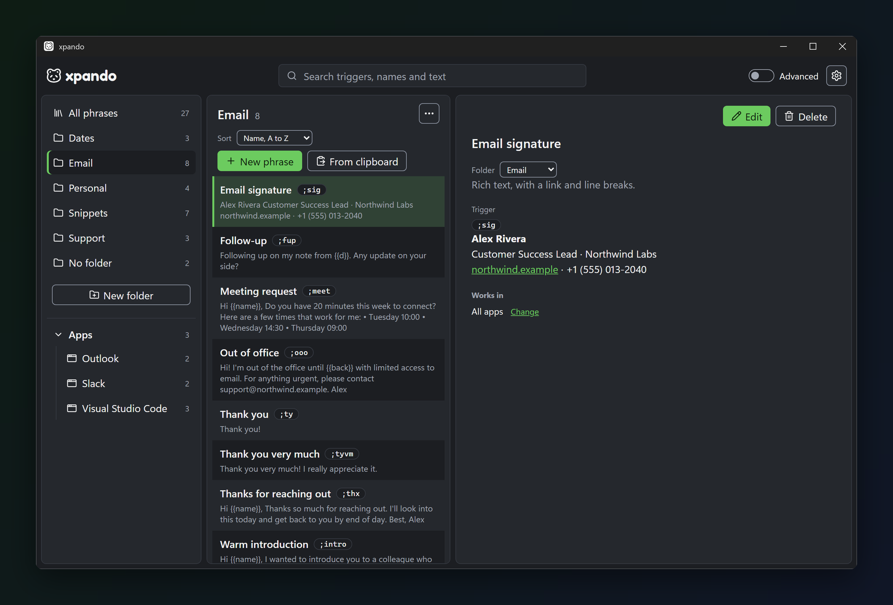</p>

</details>

## Install

Get the installer for your system from the [latest release](https://github.com/ultimatejimmy/xpando/releases/latest):

| System | File |
| :----- | :--- |
| Windows (primary) | `xpando_<version>_x64-setup.exe` |
| macOS | `xpando_<version>_universal.dmg` |
| Linux | `xpando_<version>_amd64.AppImage` or `.deb` |

Versions are date-based (for example `2026.11.24`, with betas like `2026.11.24-beta`, which are
marked pre-release). xpando checks for updates daily and can install them for you. See the
[wiki](https://github.com/ultimatejimmy/xpando/wiki) for a guided tour and
[docs/xpando/RELEASING.md](docs/xpando/RELEASING.md) for how releases are made.

## Support

xpando is free. If it saves you time, you can support it via [Ko-fi](https://ko-fi.com/jimmypautz),
[Buy Me a Coffee](https://buymeacoffee.com/ultimatejimmy) or [Liberapay](https://liberapay.com/ultimatejimmy).
A star, a bug report or telling a friend helps just as much.

## Build from source

You need Rust (stable) and Node.js. On Windows, install the Visual Studio 2022
Build Tools with the C++ workload.

```powershell
cd xpando-app
npm ci --ignore-scripts
npx tauri dev
```

The app reads and writes your existing espanso `match` folder
(`%APPDATA%\espanso\match` on Windows). Run the checks with:

```powershell
cd xpando-core; cargo test
cd ..\xpando-app; npm run build
```

The engine (espanso's code plus xpando's additions) builds as before, see [Compilation.md](Compilation.md).

## Project layout

| Path | What it is |
| :--- | :--------- |
| `xpando-core/` | Rust library: parsing, format-preserving YAML edits, conflicts, folders |
| `xpando-app/` | The Tauri 2 desktop app (React and TypeScript front end) |
| `docs/xpando/` | Plan, glossary, design notes and release process |
| everything else | espanso's engine with xpando's additions, kept close to upstream so changes can be merged |

The roadmap is in [docs/xpando/PLAN.md](docs/xpando/PLAN.md) and the shared
vocabulary (for example, "macro") is in [docs/xpando/TERMS.md](docs/xpando/TERMS.md).

## Contributing

Issues and pull requests are welcome. Please keep user-facing wording consistent
with [TERMS.md](docs/xpando/TERMS.md), and run the checks above before opening a PR.
Dependencies are pinned to exact versions and installed with `--ignore-scripts`.

## Credits and license

xpando is built on [espanso](https://github.com/espanso/espanso), created by
[Federico Terzi](https://github.com/federico-terzi) and maintained by the espanso
team and contributors. Thank you all. The espanso engine, its docs and its
community live at [espanso.org](https://espanso.org).

xpando is free software, licensed under the [GPL-3.0 license](LICENSE), the same
license as espanso. The panda icon is from [Lucide](https://lucide.dev), and the
wordmark font is Fredoka (SIL Open Font License).
