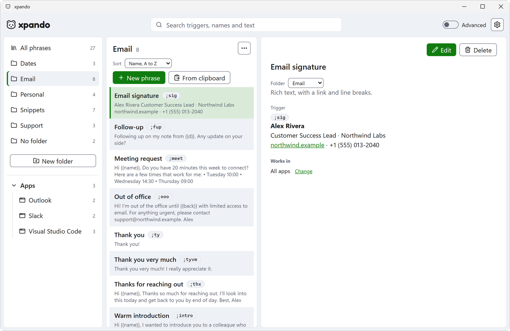

# The Phrase Manager

The xpando window has three panes. This page explains each one and the everyday jobs: finding, adding, editing and deleting phrases.

(The phrases in the pictures are made-up examples.)

## The header

* **Search box**: "Search triggers, names and text". See [Search](2.6-Search).
* **Advanced** switch: shows the technical side. See [Advanced Mode](3.1-Advanced-Mode).
* **Settings** (the gear): your data folder, import from espanso, start at sign-in, the search shortcut and updates. See [Settings and Data Folder](4.1-Settings-and-Data-Folder).

You can make the left and middle panes wider or narrower by dragging the thin line between panes (or by focusing it and using the left and right arrow keys). Double-click the line to go back to the normal width. xpando remembers the widths.

## The left pane: folders and apps

* **All phrases** shows everything, with a count.
* Below it are your **folders**, in A to Z order. A folder is a label you put on phrases to keep them tidy. Click one to see only its phrases. Phrases without a folder are listed under **No folder** (this entry appears once you have at least one folder).
* **New folder** adds a folder. See [Folders and Apps](2.5-Folders-and-Apps).
* **Apps** lists the programs that some of your phrases are limited to (for example Outlook or Slack). Click a program to see the phrases that work in it. The list only shows programs that have phrases. Click the **Apps** heading to fold the list away.

## The middle pane: the phrase list

The heading shows what you are looking at ("All phrases", a folder name or a program) and how many phrases it has. When a folder is selected, a **...** button (**Folder options**) lets you rename or delete that folder.

* **Sort** chooses **Name, A to Z** or **Order in the file**. xpando remembers your choice.
* **New phrase** starts a new phrase.
* **From clipboard** starts a new phrase from whatever you copied (see below).
* Each row shows the phrase's name, its trigger in a small tag, and the start of its text. A phrase without a name shows its trigger as the name.

If you type in the search box, the list shows only the phrases that match, inside whatever you have selected on the left. Choose **All phrases** to search everything.

## The right pane: details

Click a phrase to see it. You get:

* **Edit** and **Delete** buttons.
* The phrase name and a **Folder** menu to move it to another folder (or **No folder**).
* Its description, if it has one.
* Its **Trigger** (or **Triggers**).
* Its text. Rich text is shown formatted. In plain text, macros such as `{{name}}` are highlighted.
* A **Macros** list, if the phrase has any.
* **Works in**, with a **Change** link. See [Folders and Apps](2.5-Folders-and-Apps).

## Add a phrase

1. Select the folder or program you want the phrase in (optional).
2. Click **New phrase**.
3. Fill in the form and click **Save**. The form is explained in [Writing Phrases](2.2-Writing-Phrases).

A new phrase starts in the folder you were viewing. If you were viewing a program under **Apps**, it starts as "Only" that program.

## Add a phrase from the clipboard

1. Copy some text. It can be formatted text from Word, Outlook, Excel, Google Docs or a web page.
2. Click **From clipboard**.
3. xpando opens the new phrase form with your text already in it. Formatted text opens as **Rich text**. Plain text opens as **Plain text**. A note under the text says if something could not be kept.
4. Type a trigger and click **Save**. The trigger starts empty.

If your computer does not let xpando read the clipboard, a message says so. Then make a new phrase and paste with **Ctrl+V** into the text box.

## Edit a phrase

1. Click the phrase, then **Edit**.
2. Change what you like.
3. Click **Save** (or **Ctrl+S**). Click **Cancel** (or press **Esc**) to leave without saving.

An **Unsaved changes** note shows while you have edits. If you try to leave with unsaved edits, xpando asks **Discard your changes?** and you can choose **Keep editing** or **Discard changes**.

If the file was changed by something else while you were editing (for example a sync service), xpando does not overwrite it. It shows a message with a **Reload** button. If the phrase itself turns out to have changed, your draft is kept on screen, read-only, with a **Copy draft** button, so nothing you typed is lost.

## Delete a phrase

1. Click the phrase, then **Delete**.
2. xpando asks **Delete "name"?** and shows the trigger. Click **Delete phrase** to confirm, or **Cancel**.

Deleting cannot be undone from the app. xpando keeps a one-time backup copy of each file (with `.bak` added to its name) from before the first time it changed that file, but that is a safety net, not an undo for each delete.

## Things that cannot be edited here yet

Some phrases are shown read-only or partly read-only:

* **Regex triggers**: "Regex triggers can't be edited here yet."
* Phrases whose text is stored as markdown, an image path or a form: the text is shown but cannot be changed in the editor.

You can still change these in [Advanced Mode](3.1-Advanced-Mode) by editing the YAML.

## Phrases that could not be read

If a file has an entry xpando cannot read, a note at the top says "N entries could not be read" and lists them. The rest of the phrases still work.

---

Related pages: [Writing Phrases](2.2-Writing-Phrases) | [Folders and Apps](2.5-Folders-and-Apps) | [Search](2.6-Search) | [Advanced Mode](3.1-Advanced-Mode)
