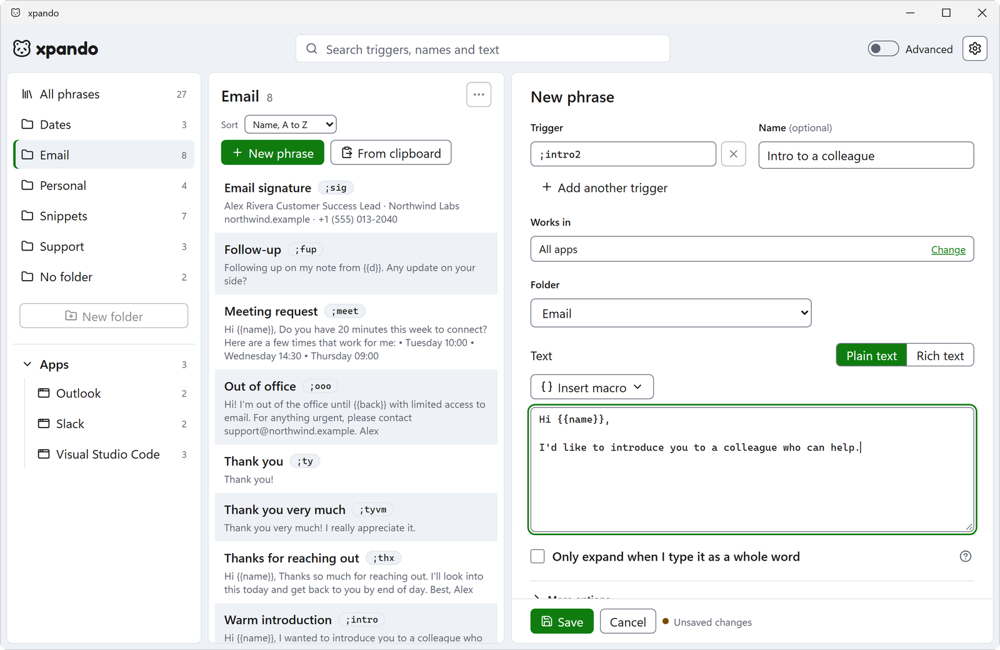

# Writing Phrases

This page explains every part of the phrase form: triggers, names, the text, and the options that decide when a phrase expands.

To open the form, click **New phrase**, or select a phrase and click **Edit**.

## Triggers

The **Trigger** is what you type to get the phrase. For example `;sig`.

* **One trigger is enough.** To give the same phrase more than one trigger, click **Add another trigger**. The label then changes to **Triggers**. To drop one, click the **X** next to it (you cannot remove the last one).
* **Start with a symbol.** Triggers such as `;sig` or `:sig` are safer than `sig`, because `sig` would also fire inside words like "design" unless you use the whole-word option below.
* **Triggers are exact.** xpando expands as soon as you type the last character of the trigger (unless you use a word option below). Capital letters matter, unless you turn on **Match the capitalization I type**.
* A trigger cannot be empty, cannot be listed twice, and cannot be used by another phrase in the same file. The form tells you ("Can't save yet: ...").
* If another phrase in a different file uses the same trigger, you get a warning ("... is also used in ... espanso may expand either one."). See [Trigger Conflicts](3.2-Trigger-Conflicts).

## Name and description

* **Name (optional)** is what the phrase is called in the list and in search. Without a name, the list shows the trigger.
* **Description** (under **More options**) is a note for yourself. It is shown under the phrase's name and found by the `comment:` search operator in [Advanced Mode](3.1-Advanced-Mode). In the file it is saved as a `#` comment above the phrase.

## Folder and Works in

* **Folder** files the phrase under a label to keep things tidy. Choose **No folder** for none.
* **Works in** says in which programs the phrase expands. **All apps** is the default. Click **Change** to limit it to certain programs.

Both are explained in [Folders and Apps](2.5-Folders-and-Apps).

## Text

**Text** is what xpando types. Use the **Plain text / Rich text** switch above the box to choose.

* **Plain text**: exactly what you type, including line breaks.
* **Rich text**: bold, links, lists, tables and more. See [Rich Text](2.3-Rich-Text).

**Insert macro** (above the text) adds changing pieces such as today's date. See [Macros](2.4-Macros).

## Whole word

**Only expand when I type it as a whole word** is a checkbox under the text. Turn it on and the trigger only expands when it has a space or punctuation on both sides, so it does not fire inside another word. The little **?** next to it explains the option.

Example: with this on, the trigger `sig` expands when you type `sig` on its own, but not inside "design".

## More options

Click **More options** to open the rest. xpando shows a short summary of what is set even while the section is closed.

### Matching

* **Match the capitalization I type**: typing the trigger capitalised or in capitals gives a capitalised or all-capitals result. Example: a phrase with trigger `btw` and text "by the way" can give "By the way" when you type `Btw`, and "BY THE WAY" when you type `BTW`.

[Advanced Mode](3.1-Advanced-Mode) adds more matching choices here: **Only expand at the start of a word**, **Only expand at the end of a word**, and **Capitals style** (what a trigger typed in capitals gives: **Default (all capitals)**, **All capitals**, **First letter only** or **First letter of each word**). If a phrase already uses one of these and Advanced mode is off, a note tells you it is set and that you can change it with Advanced turned on. Nothing is lost.

### Description

See above.

### Search terms

Extra words that find this phrase in the search box you open with a shortcut from any program ([Search](2.6-Search)). Type a word, then click **Add** (or press Enter). They do not change what is typed. Note that the search box in the xpando window does not look at search terms.

### Insertion (Advanced mode only)

**How the text is inserted** has three choices: **Automatic** (the best choice), **Paste from the clipboard** and **Type with the keyboard**. Use paste if typing drops characters, or typing if a program blocks paste. Rich text is always pasted.

## Saving

* **Save** or **Ctrl+S** saves. **Cancel** or **Esc** leaves.
* **Save** stays greyed out until there is something to save. If something is wrong, the note next to it says what.
* Enter inside a single-line box never saves by accident.
* xpando keeps your comments and layout in the file and writes the file in one safe step. If the file changed on disk since you opened it, xpando refuses to overwrite it and offers **Reload**.

## Limits

Regex triggers (patterns instead of fixed text) and phrases whose text is stored as markdown, an image path or a form can be viewed but not fully edited here yet. Use [Advanced Mode](3.1-Advanced-Mode) to edit their YAML.

---

Related pages: [The Phrase Manager](2.1-The-Phrase-Manager) | [Rich Text](2.3-Rich-Text) | [Macros](2.4-Macros) | [Folders and Apps](2.5-Folders-and-Apps) | [Trigger Conflicts](3.2-Trigger-Conflicts)
