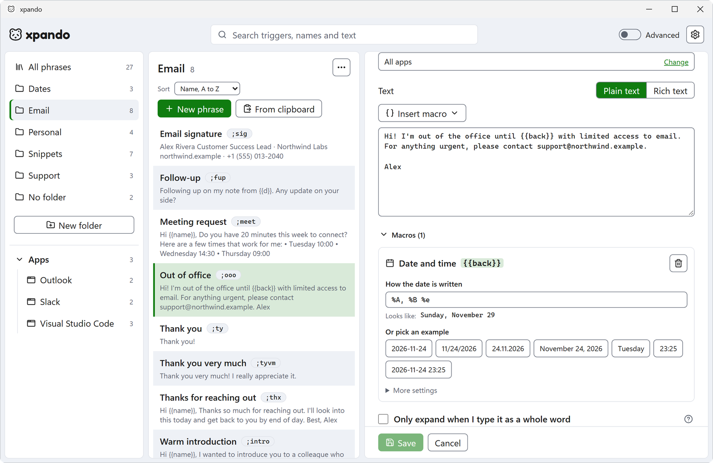
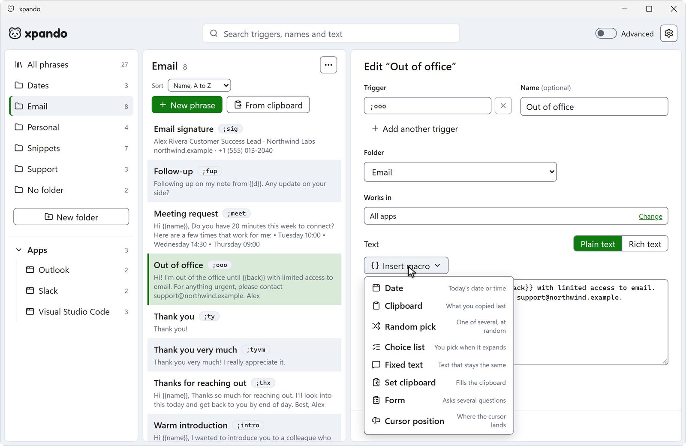
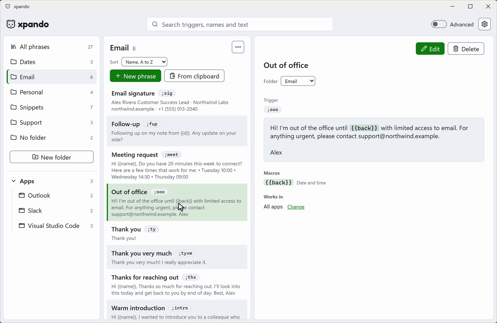

# Macros

A **macro** is a changing piece of a phrase. It is filled in at the moment the phrase expands: today's date, what you copied last, a name you pick from a list. In the text it shows as `{{name}}`.

## Add a macro to a phrase

1. Edit a phrase (or start a new one).
2. Click **Insert macro**, above the text, and choose one.
3. xpando puts `{{name}}` into the text at the cursor and adds a card for it under **Macros**.
4. Fill in the macro's settings on its card.
5. Save.

Good to know:

* The **Macros** section lists every macro in the phrase. Click its heading to open or close it.
* To remove a macro, click the trash button on its card. xpando also removes `{{name}}` from the text, and offers **Undo**.
* A macro that is not in the text says **Not in the text yet** and offers **Remove it**.
* A macro only runs when its `{{name}}` is in the text.
* If a macro uses another macro, xpando puts them in the right order for you. You cannot remove a macro that another one uses until you change that one.
* The menu in normal mode has the everyday macros. [Advanced Mode](3.1-Advanced-Mode) adds **Command output** and **Program output**, and an **Add a macro** button that adds a macro without putting it in the text.

## The macros

### Date

Today's date or time.

* **How the date is written** is a pattern. It starts as `%Y-%m-%d` (for example 2026-11-24). Under it, **Looks like** shows a live preview, and **Or pick an example** gives one-click formats such as `11/24/2026`, `November 24, 2026`, `Tuesday` and `23:01`.
* Under **More settings**: a list of what the codes mean (**Build your own**), **Shift by (seconds)** (for example `86400` is tomorrow and `-3600` is an hour ago), **Language of month and day names** (for example `de-DE`) and **Time zone** (for example `Europe/Berlin`).
* The preview is approximate. The engine writes the final result.

Common codes: `%Y` year, `%m` month, `%d` day, `%H` hour (00-23), `%M` minute, `%B` month name, `%A` weekday name.

Example: an out-of-office phrase "Hi! I'm out of the office until {{back}}", where `back` is a Date macro with the format `%A, %B %e`. On 24 November 2026 it gives "...until Tuesday, November 24".

### Clipboard

What you copied last. It has nothing to set.

Example: a phrase "Hi {{name}}," where `name` is a Clipboard macro. Copy a person's name, type the trigger, and the name is filled in. The clipboard needs to hold text.

### Random pick

One option from your list, chosen at random each time.

* Click **Add option** to add more. Click the **X** to remove one. You need at least one.

Example: options "Hi", "Hello" and "Hey" for a varied greeting.

### Choice list

A list that pops up when the phrase expands. You choose one option and it is typed.

* Add the options the same way as for Random pick.
* If the options in the file have an id and a label, the card says "These values have an id and a label. Edit it as YAML." Use [Advanced Mode](3.1-Advanced-Mode) for that.

Example: options "Formal" and "Friendly" for the closing line of an email.

### Fixed text

Text that stays the same. It is **Text to insert**, and it can use other macros, for example `{{date}}_{{clipboard}}`.

This is useful for combining other macros into one piece, or for text you want to reuse inside other macros.

### Set clipboard

Puts text on the **clipboard** after the phrase has been typed, ready for you to paste somewhere else. The macro itself inserts nothing into the text.

* One setting: **Text to put on the clipboard**. It can use other macros.
* Example: a phrase with the text `{{out}}`, where `out` combines a Date and a Clipboard macro, can also leave that same text on the clipboard.

Things to know:

* **It only works with xpando's own engine.** The engine that comes with xpando understands it. Stock espanso reports an error for a file that uses it.
* The clipboard is set **after** the phrase is inserted. xpando normally restores your old clipboard after pasting. This macro deliberately replaces it afterwards, so its text is what stays on the clipboard.
* If the phrase fails (for example a form is cancelled), nothing is put on the clipboard.
* If several Set clipboard macros run, the last one wins.
* Put it after the macros it uses.
* The phrase text must contain at least one `{{...}}` reference. Macros are only run when the text mentions one, so a text without any would never set the clipboard.
* If xpando cannot find its own engine, a warning on the phrase says "This phrase uses a Set clipboard macro, but xpando's engine was not found, so it will not run."
* It has been tested with automated tests, but not yet by hand on every system (macOS and Linux in particular).

**Old PowerShell trick:** in Advanced mode, a phrase whose macro only runs `Set-Clipboard` through PowerShell shows an offer with **Preview conversion**. Click **Convert** to change that one macro into a Set clipboard macro. Nothing changes until you click **Convert**.

### Form

Asks you several questions when the phrase expands, then fills in your answers.

* **What the form looks like**: write the text of the form and put `[[name]]` where an answer goes.
* **The questions (written as YAML)**: one entry for each `[[name]]` in the layout. For example a line `name:` and below it, indented, `type: text`.

Example layout: `Dear [[name]], thanks for your order [[order]].` with a question for `name` and one for `order`.

The questions are written as YAML. See the [espanso forms documentation](https://espanso.org/docs/matches/forms/) for the field types.

### Cursor position

Choose where the text cursor lands after the text is typed. This is not a card: **Insert macro** puts the marker `$|$` into the text.

Example: a code snippet `console.log('$|$');` leaves the cursor between the quotes.

It is only available in plain text. In rich text it is greyed out.

## Advanced mode macros

These two run things on your computer, so they only appear when [Advanced Mode](3.1-Advanced-Mode) is on. Only use commands and programs you understand.

### Command output

Runs a command and inserts what it prints.

* **Command to run** can use other macros.
* Under **More settings**: **Run it with** (the shell, or **Default for this system**), **Trim spaces and line breaks around the output**, and **Write details to the log (for troubleshooting)**.

### Program output

Runs a program and inserts what it prints.

* **Program or argument**: the first line is the program, the lines after it are passed to it. Click **Add an argument** for more.
* Under **More settings**: the same checkboxes as Command output, plus **Carry on if the program fails**.

## Changing a macro in Advanced mode

With Advanced on, each card also lets you rename the macro (**Name**; letters, digits and `_`, not starting with a digit), change **What it fills in** (changing it clears the settings, with **Undo**), and shows other settings the card has no field for. When you rename a macro, xpando changes `{{name}}` in the text and in other macros too. The file's own names for settings (`format`, `cmd`, ...) appear next to the labels.

---

Related pages: [Writing Phrases](2.2-Writing-Phrases) | [Rich Text](2.3-Rich-Text) | [Advanced Mode](3.1-Advanced-Mode) | [Troubleshooting](5.2-Troubleshooting)
