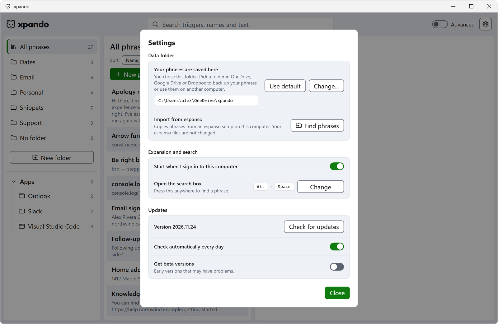

# Updates

xpando tells you when a new version is available. **You decide when to install it.** It never installs anything on its own.

## How you find out

* **Once a day.** When xpando starts (and while its window stays open), it checks GitHub, where xpando's releases are published, for a newer version. If there is one, a notice appears under the header: **Version 2026.11.24 is available**.
* **Whenever you like.** Open **Settings**, go to **Updates** and click **Check for updates**. It tells you "You have the newest version." or which version is available.
* **Quietly.** If you are offline or GitHub cannot be reached, the daily check says nothing and tries again later. Only the **Check for updates** button shows an error.

The check only asks GitHub for the list of xpando releases. It sends no information about you or your computer.

## The notice

| Button | What it does |
|---|---|
| **Update now** | Downloads the new version, checks it, and installs it. |
| **Later** | Hides the notice until you start xpando again. |
| **Skip this version** | Stops the daily check from telling you about this version. A newer version is still announced. |

Where an update cannot be installed by xpando itself, the first button says **Download** instead (see below).

## What "Update now" does

1. xpando downloads the update from xpando's releases on GitHub and shows the progress.
2. It checks the update's **digital signature**. Every official update is signed with a private key that only the xpando maintainer has. The matching public key is built into the app. If the signature is missing or does not match, xpando discards the download and installs nothing.
3. **Windows:** xpando stops its engine, starts the installer (a small progress window, no questions) and closes itself so the update can finish.
4. **macOS and Linux (AppImage):** xpando replaces the app in place. Close xpando and start it again to use the new version.
5. **Linux, installed another way (for example from the `.deb`):** xpando cannot replace itself, so it opens the release page in your browser. Download and install from there.

Your phrases and settings are not touched by an update.

## Beta versions

Betas are early versions, released so people can try new things first. They may have problems that finished versions do not.

* Turn on **Get beta versions** (Settings, under **Updates**) to hear about betas as well as finished versions. A beta is labelled **Beta**, with a note that it may have problems.
* Leave it off (the default) and you only see finished versions.
* If you use a beta and then turn beta versions off, xpando keeps your beta until a finished version that is **newer** comes out. It never replaces your version with an older one.

On the GitHub Releases page, betas are marked **Pre-release**. The **latest release** link in this wiki always points to the newest finished version.

## Settings

| Setting | Meaning |
|---|---|
| **Check automatically every day** | On by default. Turn it off to check only when you click the button. |
| **Get beta versions** | Off by default. |

Both are saved in `settings.yml` in xpando's settings folder (next to the setting for your [data folder](4.1-Settings-and-Data-Folder)), as `auto_check` and `update_channel` (`stable` or `beta`).

## Version names

Versions are **dates**.

| Release | Version and tag | On GitHub |
|---|---|---|
| Stable, first of the day | `2026.11.24` | normal release (marked Latest) |
| Patch to that day's release | `2026.11.24.1`, `2026.11.24.2` | normal release |
| Beta | `2026.11.24-beta`, `2026.11.24-beta2`, `2026.11.24-beta3` | **pre-release** |

* The tag is exactly the version, with no `v` in front.
* Months and days have no leading zero (`2026.1.5`).
* A patch always has a number from 1 (never `.0`).
* Betas lead up to a stable release. A stable release after betas has the date it ships, which can differ from the dates in the beta names (for example `2026.11.23-beta3` could be followed by `2026.11.25`).
* The order for one day is: `-beta` is older than `-beta2`, which is older than the stable release, which is older than `.1`, then `.2`.

Your settings screen shows the version you have, for example **Version 2026.11.24**. The full release process is in the repository: [docs/xpando/RELEASING.md](https://github.com/ultimatejimmy/xpando/blob/dev/docs/xpando/RELEASING.md).

## If something goes wrong

* **"Could not reach GitHub. Check your internet connection and try again."**: check your connection. A company network or firewall may block GitHub.
* **A message about the signature**: the download was damaged or changed on the way, or it was not signed by xpando. xpando discarded it. Try again later, or download the installer yourself from the [releases page](https://github.com/ultimatejimmy/xpando/releases) (and [check it](1.1-Installation#check-your-download)).
* **"was downloaded, checked and installed" but you still see the old version on macOS or Linux**: close xpando completely and start it again.
* xpando uses the `curl` program to look for updates. Windows 10 and later, macOS and most Linux systems have it.

---

Related pages: [Installation](1.1-Installation) | [Settings and Data Folder](4.1-Settings-and-Data-Folder) | [FAQ](5.1-FAQ)
