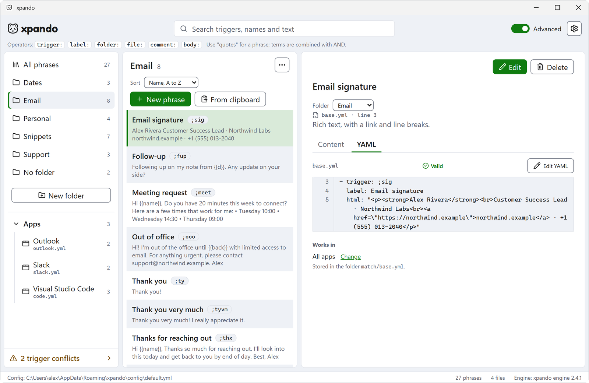
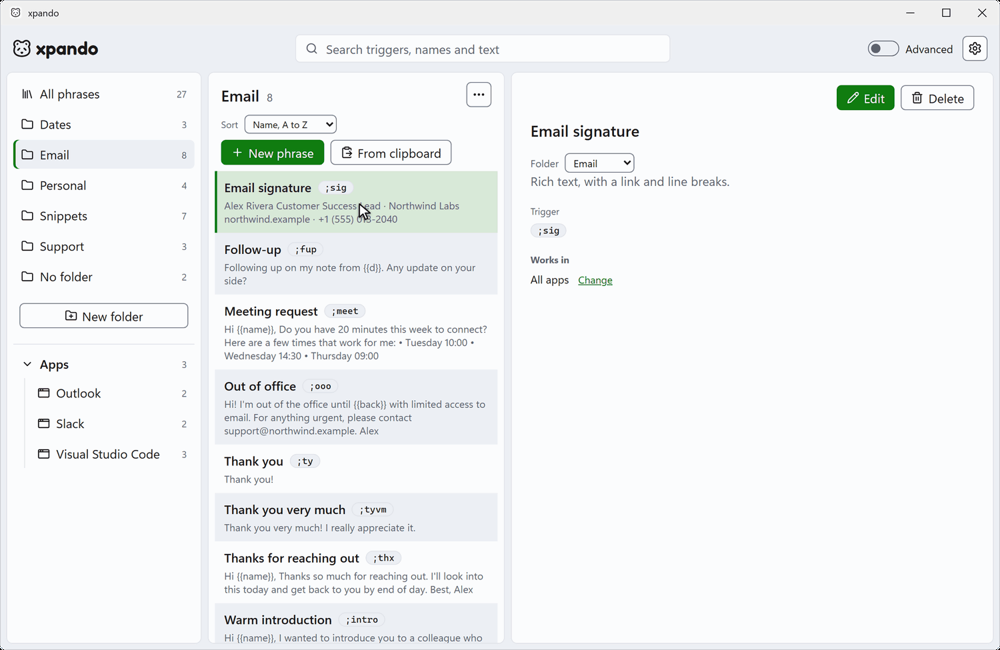

# Advanced Mode

The **Advanced** switch in the header shows the technical side of xpando. Use it when you want to see exactly what is saved, fix a file by hand, or use an option the normal form keeps out of the way.

Nothing disappears when Advanced is off. Every feature stays reachable through **More options** or through this switch. xpando remembers the switch between runs.

## What Advanced adds

* **Search operators** such as `trigger:` and `body:`. A line under the search box lists them. See [Search](Search).
* **Content and YAML tabs** on the phrase details. See below.
* **File and line**: under a phrase name, a small line shows the file and line, for example `base.yml · line 3`. Under **Works in**, a note says which file the phrase is stored in and which config files load it.
* **File names in the Apps list**, and **Apps with no phrases** show too, so nothing is hidden.
* **Option tags**: under the phrase's triggers, small tags such as "Whole word" or "Match case".
* **More options for a phrase**: **Only expand at the start of a word**, **Only expand at the end of a word**, **Capitals style** and **How the text is inserted**. **More options** opens by itself. The file's own name for each option is shown next to it (for example `word` and `propagate_case`). See [Writing Phrases](Writing-Phrases).
* **More macros**: **Command output** and **Program output**, an **Add a macro** button, and cards you can rename and retype. See [Macros](Macros).
* **More rich text tools**: subscript, superscript, font, font size, indents, line spacing and tables. See [Rich Text](Rich-Text).
* **Trigger conflicts**: a list at the bottom of the left pane. See [Trigger Conflicts](Trigger-Conflicts).
* **A status bar** at the bottom of the window. See below.
* **A way to type a program file name** such as `winword.exe` in the program picker of **Works in**, and a list of the files that will change before a phrase is moved.
* **The PowerShell conversion offer** for old clipboard tricks (see [Macros](Macros)).

## The YAML tab

Your phrases are stored in YAML files (a plain text format that espanso uses). With Advanced on, select a phrase and open the **YAML** tab to see its exact source with the file's real line numbers. It shows **Valid** or **Invalid** and the reason.

### Edit one phrase

1. Select a phrase and open the **YAML** tab.
2. Click **Edit YAML**.
3. Change the text. **Tab** adds two spaces and **Shift+Tab** removes them.
4. Watch the status line. It says **Checking...**, then **Valid**, or "Line 4, column 3: ..." with a **Go to** button for the error.
5. Click **Save** (or press **Ctrl+S**). **Cancel** or **Esc** leaves.

The comment block above the phrase is part of the text you edit.

### Edit the whole file

Turn on the **Whole file** switch to edit every phrase and top-level key in the file (such as `imports`). If your change would remove phrases, xpando lists them and you must tick **Remove these phrases from the file** before **Save** works.

Switching between one phrase and the whole file asks first if you have unsaved text: **Discard your changes?** with **Discard** or **Keep editing**. Unsaved YAML text also survives selecting another phrase and coming back (until you close xpando).

### The safe-save rules

The same safety net as the normal form applies:

* The text must be valid YAML and must be exactly one phrase (when editing one phrase). **Save** is disabled while it is not.
* Every **other** phrase in the file must come out unchanged, or the save is refused.
* The file is written in one step. If it changed on disk since you opened it, xpando refuses and offers **Reload**. Your edit is kept and checked against the new version.
* xpando keeps a one-time `.bak` backup of the file from before its first change, and keeps your comments and layout.

## The status bar

At the bottom, with Advanced on:

* **Config:** where your data folder is.
* The number of **phrases** and **files**.
* **Engine:** which engine xpando found and its version, for example "xpando engine 2.4.1". Hover over it to see the file location.

## All match options

These are the options a phrase can have, and where to find them (the file's name for the option is in brackets). Each option is explained in [Writing Phrases](Writing-Phrases).

| Option | Label | Shown in |
|---|---|---|
| `word` | **Only expand when I type it as a whole word** | Always |
| `propagate_case` | **Match the capitalization I type** | More options |
| `left_word` | **Only expand at the start of a word** | Advanced only |
| `right_word` | **Only expand at the end of a word** | Advanced only |
| `uppercase_style` | **Capitals style** (needs **Match the capitalization I type**) | Advanced only |
| `force_mode` | **How the text is inserted**: **Automatic**, **Paste from the clipboard** or **Type with the keyboard** | Advanced only |
| `search_terms` | **Search terms** | More options |
| Description (a `#` comment) | **Description** | More options |

Options that Advanced mode shows are still saved and kept when it is off.

## Where to go for more

xpando phrases use espanso's file format. For everything the format can do (regular expressions, global variables, imports), see the [espanso documentation](https://espanso.org/docs/matches/basics/). Remember that a few things are xpando's own: the `set_clipboard` macro type and the `xpando_folder:` line are understood only by xpando's engine, not by stock espanso (which ignores `xpando_folder`).

---

Related pages: [Trigger Conflicts](Trigger-Conflicts) | [Search](Search) | [Macros](Macros) | [Settings and Data Folder](Settings-and-Data-Folder)
