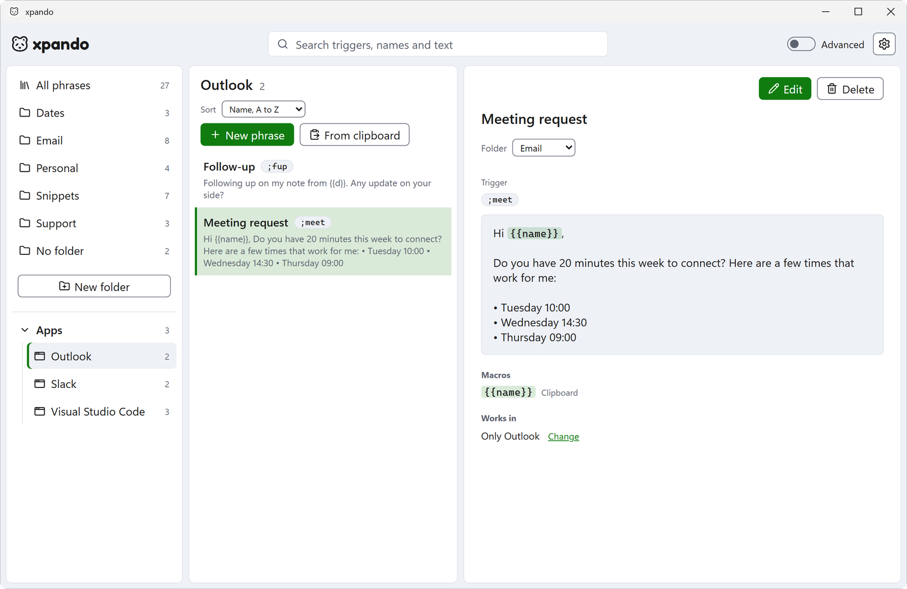
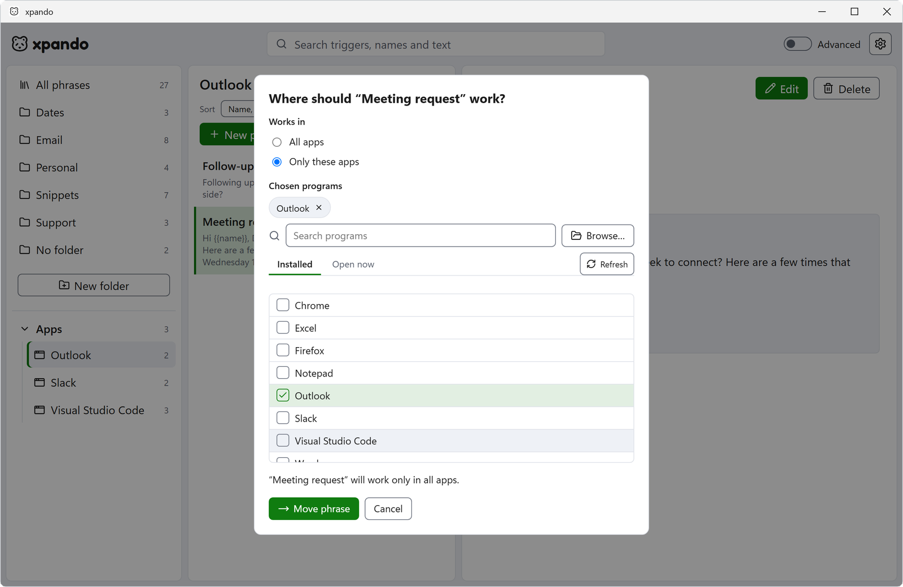
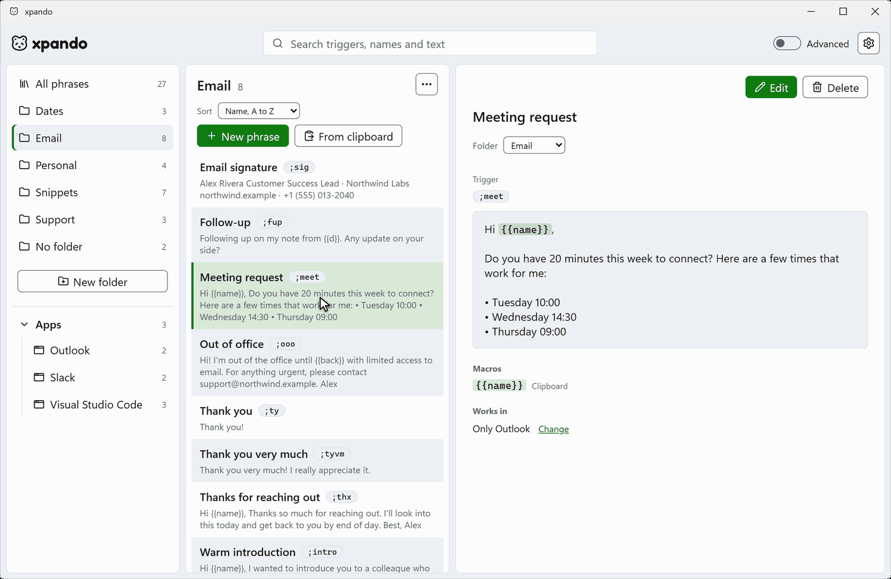

# Folders and Apps

Folders and apps are two separate ways to organise phrases.

* A **folder** is only a label. It helps **you** find things ("Email", "Dates", "Support"). A folder never changes where a phrase works.
* **Works in** decides **which programs** a phrase expands in: **All apps**, or **Only these apps**. The **Apps** list in the left pane shows the programs your phrases are limited to.

## Folders

### Make a folder

1. Click **New folder** (under the folder list).
2. Type a **Folder name** and click **Create folder**.

A folder name can be up to 60 characters, and two folders cannot have the same name (capital letters do not count). A new folder stays in the list even while it is empty.

### Put a phrase in a folder

* In the phrase details, use the **Folder** menu. Choose a folder, or **No folder**.
* In the phrase form (**New phrase** or **Edit**), use the **Folder** menu there.
* A new phrase starts in the folder you were looking at.

A phrase is in one folder, or in none. Phrases in no folder show under **No folder** and under **All phrases**.

### Rename or delete a folder

1. Click the folder in the left pane.
2. Click the **...** button (**Folder options**) in the middle pane.
3. Choose **Rename folder** or **Delete folder**.

Deleting a folder does **not** delete its phrases. They stay in your list, in no folder. xpando says so before you confirm.

### Folders you already had

If you imported phrases, or had files from before folders became labels, each phrase file shows as a folder named after the file. For example phrases in `base.yml` appear in a folder called `base` until you file them elsewhere. Phrases in files that xpando made for one program start in no folder.

## Which programs a phrase works in

Every phrase has a **Works in** setting.

* **All apps** (the default): it expands everywhere.
* **Only these apps**: it expands only in the programs you pick, for example Outlook.

You can see it in the phrase details and in the editor. Click **Change** to open the dialog **Where should "name" work?**

### Choose the programs

1. Choose **Only these apps**.
2. Pick programs from the list. You can search by name in **Search programs**.
   * **Installed**: programs xpando found on this computer (Windows only). The first look can take a few seconds. **Refresh** looks again.
   * **Open now**: programs that have a window open right now. If your program is missing, open it first.
   * **Browse...** lets you pick a program file yourself.
3. Chosen programs appear as tags at the top, each with an **x** to remove it.
4. Read the sentence under the list. It says what will happen.
5. Click **Save**.

For a new phrase, the same box is in the form, and the choice is applied when you save. A new phrase made while a program is selected under **Apps** starts as "Only" that program.

### How it works

espanso, the engine under xpando, can limit whole phrase **files** to programs, not single phrases. So when you change **Works in**, xpando moves the phrase to a file that works in exactly those programs, and creates one if needed. You do not have to manage those files.

* Phrases for the same set of programs share one file.
* The phrase, its description and all its settings move unchanged.
* **All apps** puts the phrase back where it came from, if xpando remembers. Otherwise it goes to your main all-apps file, and you can choose another place from the **Put it in this folder** list.
* After a move, a note says **Moved "name" to the folder "...".** with an **Undo** button. Undo puts the phrase back. A file xpando created stays (empty) after an undo.
* xpando makes a one-time backup copy (`.bak`) of each file before the first change. Either both files change or neither does.

### When a move is refused

xpando tells you why, and changes nothing. For example:

* The same trigger already exists where the phrase would go (a clash).
* A file is read-only.
* The phrase comes from an installed espanso package. Change packages with espanso, not in xpando.
* The setup of that file is too unusual to change safely.

If a program limit was written by hand in a way xpando does not manage (for example by window title), the phrase details say so, and changing **Works in** moves the phrase to another file.

### The Apps list

* One entry per program, with a count. A phrase that works in several programs appears under each of them.
* Programs with no phrases are hidden. They come back when they get a phrase. [Advanced Mode](Advanced-Mode) shows all of them, with their file names.
* A message such as "No setting loads the folder ..., so this phrase does not expand" means nothing loads the file the phrase is in. Change **Works in** to fix it.

## Limits

* Programs are matched by file name (for example `winword.exe`), not by full path.
* **Installed** works on Windows only. **Browse...** is tested on Windows. On Linux it needs `zenity`, and on macOS use **Open now**. The macOS and Linux versions of the picker have not been tested.
* On macOS and Linux, **Open now** uses the list of running processes.
* Only one app setting applies to the program in front at a time: the first matching app-specific one, otherwise the general one.
* Files inside subfolders of `match` and installed packages cannot be changed here.

---

Related pages: [The Phrase Manager](The-Phrase-Manager) | [Writing Phrases](Writing-Phrases) | [Advanced Mode](Advanced-Mode) | [Migrating from espanso](Migrating-from-espanso)
