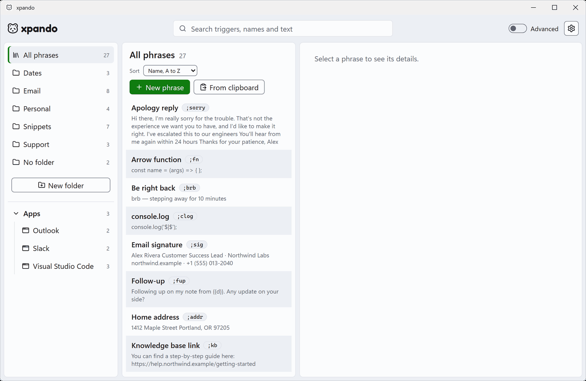
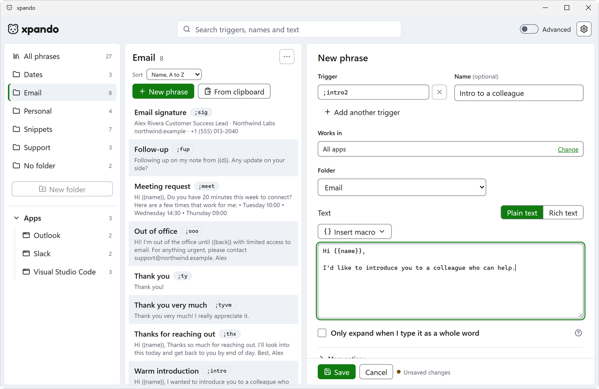

# Getting Started

This page takes you from a fresh install to your first working phrase in a few minutes.

## What runs on your computer

xpando has two parts:

* **The app**: the window where you manage your phrases.
* **The engine**: a background program that watches what you type. When you type a trigger, it types your phrase instead.

When you open xpando, it starts the engine for you. You can close the window and your phrases keep working, because the engine keeps running in the background.

## First run

1. Open xpando from the Start menu (or your Applications folder, or your app launcher).
2. **If you used espanso before**, xpando may show **Bring your espanso phrases to xpando?** Choose **Import** to copy them over. Nothing in espanso's own folder is changed. See [Migrating from espanso](Migrating-from-espanso).
3. You land in the phrase manager. See [The Phrase Manager](The-Phrase-Manager) for a tour of the window.

## Make your first phrase

1. Click **New phrase** (in the middle pane).
2. Under **Trigger**, type the short text you will type to get the phrase. For example `;sig`. Start triggers with a symbol such as `;` or `:` so they do not appear in normal words by accident.
3. Optional: give it a **Name**, for example "Email signature". The name is what the list shows.
4. Under **Text**, type what you want xpando to put in. Several lines are fine.
5. Optional: click **Insert macro** to add today's date or other changing pieces. See [Macros](Macros).
6. Click **Save** (or press **Ctrl+S**).

If **Save** is greyed out, a message next to it says what to fix, for example "Can't save yet: Every trigger needs text."

## Try it

1. Click in any program: a text editor, an email, a web page.
2. Type your trigger, for example `;sig`.
3. The trigger is replaced by your text.

If nothing happens, see [Troubleshooting](Troubleshooting). The most common causes are an unsaved phrase, a typo in the trigger, or a phrase that is set to work only in another program.

## Where to go next

* Change how and when a phrase expands: [Writing Phrases](Writing-Phrases).
* Make a phrase look good: [Rich Text](Rich-Text).
* Add the date, the clipboard and more: [Macros](Macros).
* Keep things tidy: [Folders and Apps](Folders-and-Apps).
* Find phrases quickly: [Search](Search).
* Put your phrases in OneDrive, Google Drive or Dropbox: [Settings and Data Folder](Settings-and-Data-Folder).

---

Related pages: [Installation](Installation) | [The Phrase Manager](The-Phrase-Manager) | [Writing Phrases](Writing-Phrases) | [Troubleshooting](Troubleshooting)
