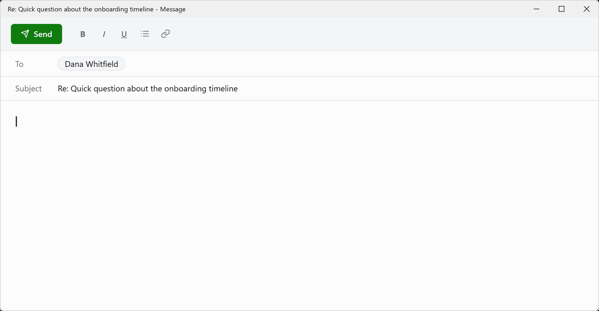
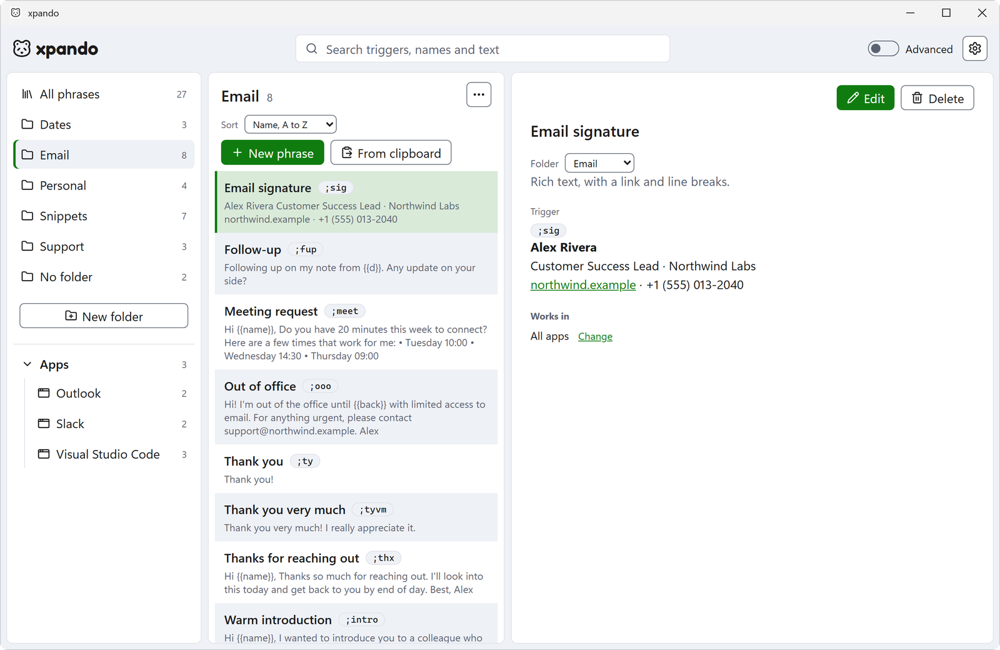

# xpando

**xpando** is a free text expander for Windows (with macOS and Linux builds too). You type a short **trigger** such as `;sig`. xpando replaces it with a whole **phrase**: your email signature, an address, today's date, a formatted reply.

xpando adds a modern phrase manager to [espanso](https://espanso.org), the open source text expander. You get a friendly window for your phrases. Under the hood, the part that watches your typing and types the text for you is xpando's own build of espanso's engine. Most of it is the same as espanso's, with changes and additions of xpando's own.

> **Status: early development.** xpando works, but it is young. Expect rough edges and keep a backup of your phrases (see [Settings and Data Folder](4.1-Settings-and-Data-Folder)). Windows is the main target. macOS and Linux builds exist but get less testing.

[**Download the latest release**](https://github.com/ultimatejimmy/xpando/releases/latest)

## What you get

* **A phrase manager.** Browse, search and edit all your phrases in one window. See [The Phrase Manager](2.1-The-Phrase-Manager).
* **Rich text.** Write formatted phrases (bold, links, lists, tables) and paste from Word. See [Rich Text](2.3-Rich-Text).
* **Macros.** Insert today's date, what you copied last, a random pick, a choice list and more. See [Macros](2.4-Macros).
* **Folders and per-app phrases.** File phrases in folders, and make a phrase work only in certain programs. See [Folders and Apps](2.5-Folders-and-Apps).
* **Search.** Find phrases fast, in the window, or press a keyboard shortcut (Alt+Space by default) in any program for a quick search box. See [Search](2.6-Search) and [Quick Search](2.7-Quick-Search).
* **Safe edits.** Your phrases stay in plain files. xpando saves them carefully and refuses to overwrite a file that changed underneath it.
* **An Advanced switch** for power users: the YAML source, trigger conflicts, every option. See [Advanced Mode](3.1-Advanced-Mode).

## Start here

1. [Install xpando](1.1-Installation).
2. Follow [Getting Started](1.2-Getting-Started) to make your first phrase.
3. Learn how to [write phrases](2.2-Writing-Phrases) with options, then add [macros](2.4-Macros).

Already using espanso? See [Migrating from espanso](4.4-Migrating-from-espanso).

## Words used in this wiki

| Word | Meaning |
|---|---|
| **Phrase** | One piece of text that xpando types for you when you type its trigger. |
| **Trigger** | The short text you type to get the phrase, for example `;sig`. A phrase can have several. |
| **Text** | What the phrase puts in. Either plain text or rich text (bold, links, lists). |
| **Macro** | A changing piece inside the text that is filled in when the phrase expands, such as today's date or what is on the clipboard. It shows in the text as `{{name}}`. |
| **Setting** | One field of a macro, for example the date format of a Date macro. |
| **Folder** | A label you put on phrases to keep them tidy. A folder has nothing to do with where a phrase works. |
| **Works in** | The programs a phrase works in: **All apps** or **Only these apps**. |
| **Advanced mode** | A switch in the header that shows the technical side: files, YAML and every option. |

## All pages

**Getting started:** [Installation](1.1-Installation), [Getting Started](1.2-Getting-Started)

**Using xpando:** [The Phrase Manager](2.1-The-Phrase-Manager), [Writing Phrases](2.2-Writing-Phrases), [Rich Text](2.3-Rich-Text), [Macros](2.4-Macros), [Folders and Apps](2.5-Folders-and-Apps), [Search](2.6-Search), [Quick Search](2.7-Quick-Search)

**Power tools:** [Advanced Mode](3.1-Advanced-Mode), [Trigger Conflicts](3.2-Trigger-Conflicts)

**Your data and updates:** [Settings and Data Folder](4.1-Settings-and-Data-Folder), [Sync Tips](4.2-Sync-Tips), [Updates](4.3-Updates), [Migrating from espanso](4.4-Migrating-from-espanso)

**Help:** [FAQ](5.1-FAQ), [Troubleshooting](5.2-Troubleshooting)

**Project:** [Building from Source](6.1-Building-from-Source), [Contributing](6.2-Contributing)

---

Related pages: [Installation](1.1-Installation) | [Getting Started](1.2-Getting-Started) | [FAQ](5.1-FAQ)
