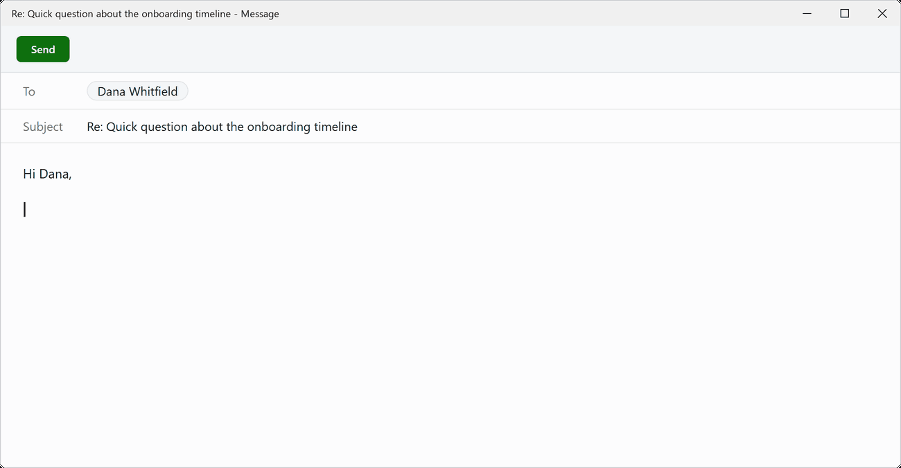
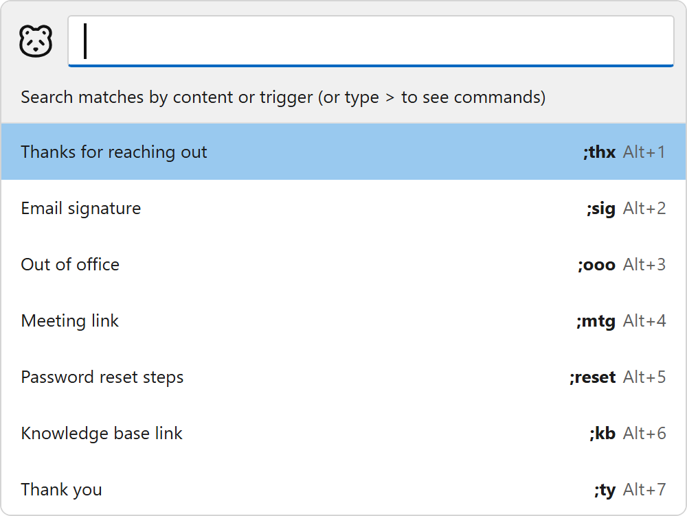
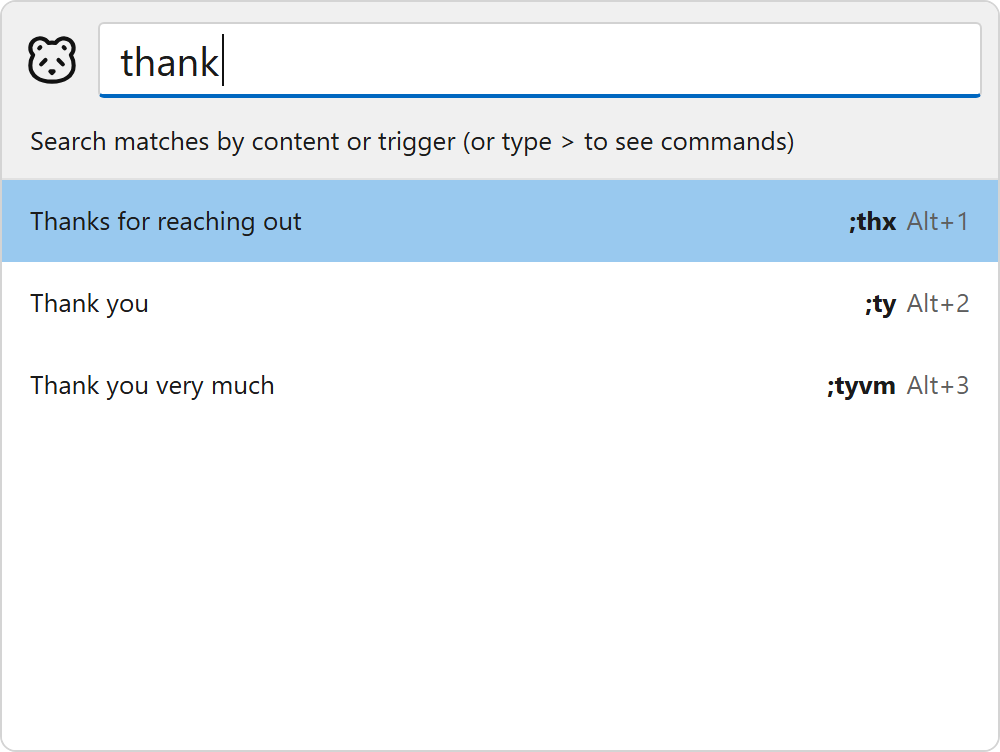
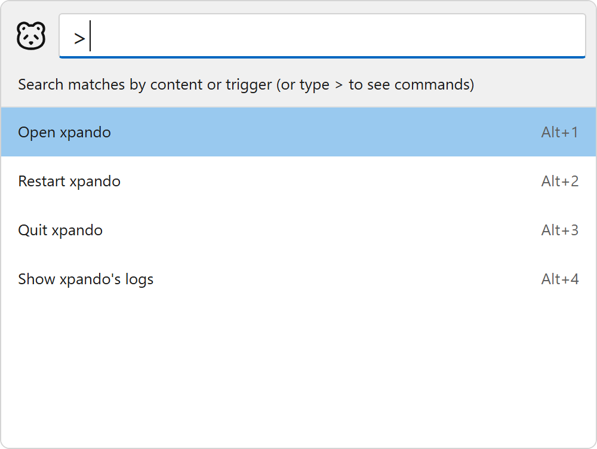

# Quick Search

Press **Alt+Space** in any program and a small search box opens. Type a few letters of a phrase, press **Enter**, and xpando types it where you were. You never have to open the xpando window.

*The screenshots on this page use sample phrases.*

## Use it

1. Click where you want the text, for example in an email or a chat box.
2. Press **Alt+Space**. The search box opens.
3. Type a few letters. The list narrows as you type.
4. Press **Enter** to type the highlighted phrase, or use one of the shortcuts below.

The search box is part of xpando's engine, so it works even when the xpando window is closed, as long as the engine is running.

## What it finds

It looks at the text of a phrase, its trigger, its name and any **Search terms** you added to it in **More options**. It does not need the whole word: "thank" finds "Thanks for reaching out", "Thank you" and "Thank you very much".

## Keyboard shortcuts

| Keys | What they do |
| :--- | :----------- |
| **Up** and **Down**, or **Tab** and **Shift+Tab** | Move through the list. **Ctrl+N** and **Ctrl+P** work too. |
| **Enter** | Type the highlighted phrase. |
| **Alt+1** to **Alt+8** | Type the first to the eighth result straight away. The number is shown next to each result. |
| **Esc** | Close the box without typing anything. |

## Commands

Type **>** to see the built-in commands instead of phrases:

* **Open xpando** opens the xpando window.
* **Restart xpando** restarts the engine. Try this if expansion stops working.
* **Quit xpando** stops the engine.
* **Show xpando's logs** opens the engine's log, which helps when you report a problem.

## Change the shortcut

1. Open **Settings** (the gear).
2. Under **Expansion and search**, find **Open the search box** and click **Change**.
3. Press the keys you want. Hold **Ctrl** or **Alt** (you can add **Shift**) and press a letter, number, F key or Space (some other keys work too).
4. Press **Esc** if you change your mind.

xpando restarts the engine for you so the new shortcut works at once. If another program already uses the same keys, choose different ones. The shortcut is stored in the `search_shortcut` line of `config/default.yml` in your data folder. If it is set to `OFF` there, Settings shows "Off."

## If nothing happens

* Check that the engine is running. xpando shows a warning in its window when it is not.
* Another program may already use **Alt+Space**. Choose a different shortcut as described above.
* On macOS and Linux the shortcut and the box come from the same engine but get less testing than Windows. See [Troubleshooting](Troubleshooting).

---

Related pages: [Search](Search) | [Settings and Data Folder](Settings-and-Data-Folder) | [Writing Phrases](Writing-Phrases) | [Troubleshooting](Troubleshooting)
