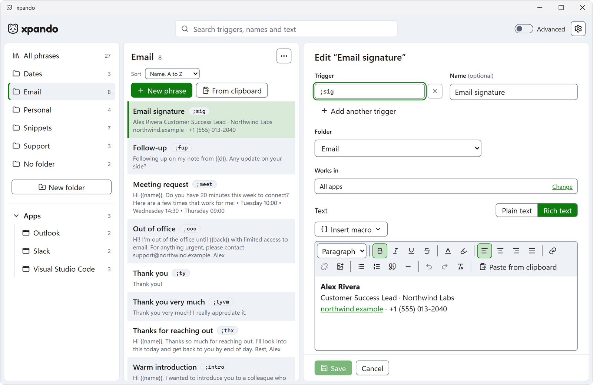
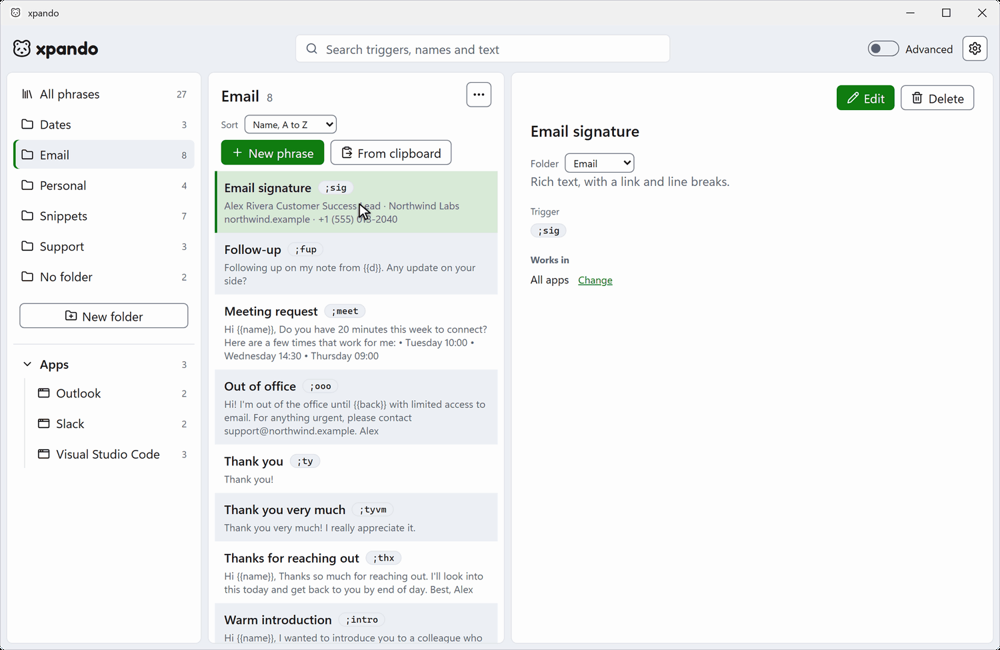

# Rich Text

A phrase can be **plain text** or **rich text**. Rich text can have bold, links, lists, colours, tables and more, so your email signature or a formatted reply looks right when it is pasted.

## Turn it on

Above the **Text** box, the **Plain text / Rich text** switch chooses how the phrase is written. Click **Rich text** and the box becomes an editor with a toolbar.

## The toolbar

From left to right, the toolbar offers:

* A text style menu (for example **Paragraph** and headings)
* **Bold**, **Italic**, **Underline**, **Strikethrough**
* **Text colour** and **Highlight**
* **Align left**, **Centre**, **Align right**, **Justify**
* **Link** and **Remove link**
* **Image**
* **Bulleted list**, **Numbered list**, **Quote**, **Horizontal line**
* **Undo**, **Redo**, **Clear formatting**
* **Paste from clipboard**

[Advanced Mode](Advanced-Mode) adds **Subscript**, **Superscript**, **Font**, **Font size**, **Decrease indent**, **Increase indent**, **Line spacing** and **Table** (insert a table, add or delete rows and columns, merge and split cells). The buttons are hidden when Advanced is off, but xpando still keeps such formatting that is already in a phrase.

## Links and images

* **Link** asks for a **Link address**. Addresses must start with `http://`, `https://`, `mailto:` or `tel:`. Other kinds are not allowed.
* **Image** asks for an **Image address (https)**. The picture is a link to a picture on the internet, not stored in the phrase. It must stay online, and some programs never show linked pictures. A small picture that comes along when you paste (up to about 300 KB) is stored inside the phrase.

## Paste from Word and other programs

You can copy formatted text from Word, Outlook, Excel, Google Docs or a web page and use it as the text of a phrase.

* **Ctrl+V** in the rich text editor pastes it with its formatting, cleaned up.
* **Paste from clipboard** (a button in the toolbar) does the same from a button. If your computer does not allow xpando to read the clipboard, it says so. Press **Ctrl+V** instead.
* **From clipboard** (next to **New phrase**) starts a whole new phrase from what you copied. See [The Phrase Manager](The-Phrase-Manager).

What happens to the formatting:

| In Word and similar | In the phrase |
|---|---|
| Bold, italic, underline, strikethrough, subscript, superscript | Kept |
| Text colour, highlight, font, font size | Kept |
| Headings, alignment, indents, line and paragraph spacing | Kept |
| Bulleted and numbered lists, including sub-levels | Kept as real lists |
| Links (`http`, `https`, `mailto`, `tel`) | Kept. Other kinds become plain text |
| Tables with borders, shading, widths, merged cells | Kept |
| Pictures on the web, or small pictures stored in the document | Kept |
| Pictures on your computer or in an email | Left out, with a note under the editor |
| Comments, hidden text, Word's style sheets | Left out |

xpando only keeps a safe set of formatting. Anything else is removed, so scripts and strange formatting cannot end up in your files. Fonts must be installed on the computer where the phrase is used.

## Switch between plain and rich

* **Plain to rich** keeps your text. Blank lines become paragraphs and single line breaks stay line breaks.
* **Rich to plain** loses formatting. xpando first tells you what would be lost ("Plain text can't hold ... Switching removes it.") and you choose **Switch to plain text** or **Keep rich text**.

## How rich text is typed into a program

Rich text is always put in through the clipboard (a paste), not typed key by key. xpando normally puts your previous clipboard back afterwards.

Programs that cannot take formatting get a readable plain version instead: paragraphs, bullet lists as `*`, and link addresses left out.

Programs differ in how they show pasted formatting (Outlook, Word, Gmail, Slack, Teams and others). xpando has not been tested against each one yet. Try your phrase where you will use it, and if something looks wrong, try simpler formatting or [report it](https://github.com/ultimatejimmy/xpando/issues).

## Macros in rich text

[Macros](Macros) work in rich text, with two cautions:

* **Cursor position** is not offered in rich text. In the **Insert macro** menu it is greyed out and says "Plain text only".
* A macro's value is inserted as is. If the clipboard holds something that looks like web markup (such as `<b>`), it is pasted as formatting. For clipboard content you do not control, prefer plain text.

## Searching rich text

The search box looks at the stored text of a phrase. For rich text that includes its formatting tags, so (in Advanced mode) a search such as `body:strong` can match a phrase that has bold text. See [Search](Search).

---

Related pages: [Writing Phrases](Writing-Phrases) | [Macros](Macros) | [The Phrase Manager](The-Phrase-Manager) | [Troubleshooting](Troubleshooting)
