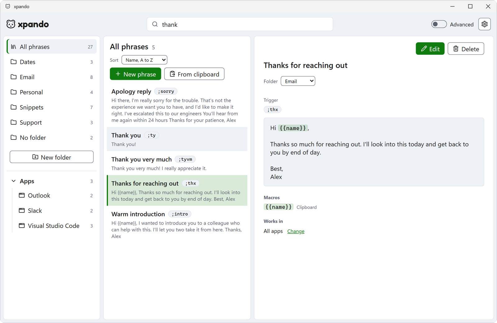
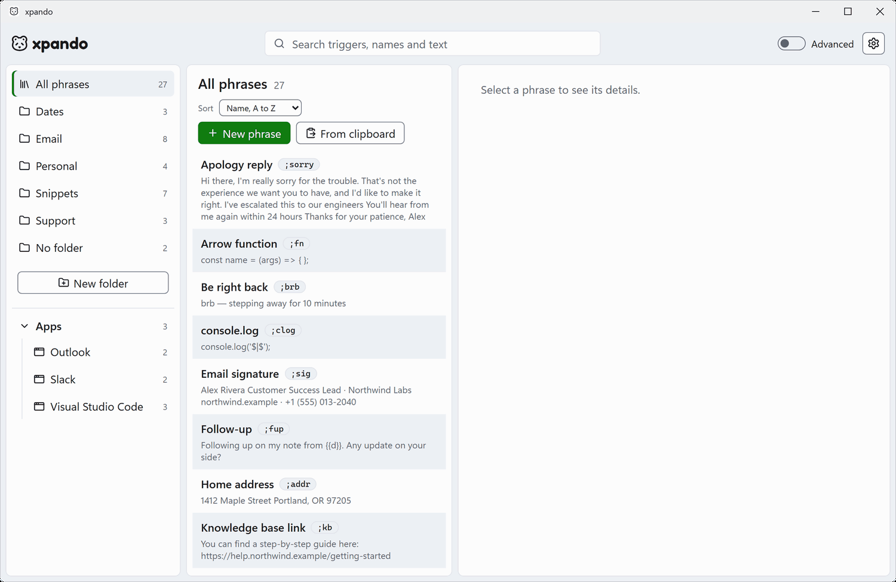

# Search

xpando has two ways to find a phrase: the **search box in the window**, and a **shortcut** that opens a small search box from any program.

## Search in the window

Type in the box at the top ("Search triggers, names and text"). The list narrows as you type.

* The search finds your text **anywhere** in a phrase's triggers, name, description and text. Capital letters do not matter.
* It searches inside what you have selected on the left. To search everything, select **All phrases**.
* If nothing matches, the list says "No phrases match your search."
* Clear the box to see the whole list again.
* If you type while editing a phrase and the search would hide it, xpando asks about your unsaved changes first.

The search in the window does **not** look at a phrase's **Search terms**. Those are for the shortcut search below.

### Advanced operators

Turn on [Advanced Mode](Advanced-Mode) to narrow a search to one part of a phrase. A line under the search box then lists the operators.

| Operator | Looks in |
|---|---|
| `trigger:` | the triggers |
| `label:` | the phrase name |
| `folder:` | the name of the file's folder, which is the file name without `.yml` (for example `base`). It does not look at the folder labels you made with **New folder** |
| `file:` | the file path (for example `base.yml`) |
| `comment:` | the description |
| `body:` | the text |

Rules:

* Type the operator, then the word, with no space: `trigger:sig`.
* **Quotes** keep several words together: `body:"kind regards"`.
* **Several terms must all match** (an AND): `file:base trigger:;sig`.
* A word with no operator looks in the triggers, name, description and text, like plain search.
* Something that is not one of the six operators, such as `:hi` or `http:x`, is treated as an ordinary word. So you can still search for a trigger that starts with a colon.
* An operator with nothing after it yet (still typing) is ignored.
* With Advanced off, the whole box is one plain search.

Examples:

* `trigger:;sig` finds the phrase whose trigger contains `;sig`.
* `folder:base` shows phrases whose file is `base.yml`. To see the phrases in one of your folders, just click that folder in the left pane.
* `file:outlook` finds phrases stored in a file with "outlook" in its name.
* `body:"{{date}}"` finds phrases that use a macro called `date`.
* For a rich text phrase, the text is stored with its formatting tags, so `body:` also sees those.

## Search from any program

Press **Alt+Space** in any program to open a search box. You can then pick a phrase and have it typed where you were.

* This search box is part of the engine, so it works even when the xpando window is closed (as long as the engine is running).
* It finds phrases using their triggers, names and **Search terms**.
* It also lists a few built-in entries such as "Open xpando", "Restart xpando", "Quit xpando" and "Show xpando's logs".

### Change the shortcut

1. Open **Settings** (the gear).
2. Under **Expansion and search**, find **Open the search box** and click **Change**.
3. Press the keys you want. Hold **Ctrl** or **Alt** (you can add **Shift**) and press a letter, number, F key or Space (some other keys work too).
4. Press **Esc** if you change your mind.

xpando restarts the engine for you so the new shortcut works at once. If another program already uses the same keys, choose different ones.

The shortcut is stored in the `search_shortcut` line of `config/default.yml` in your data folder. If it is set to `OFF` there, Settings shows "Off."

---

Related pages: [The Phrase Manager](The-Phrase-Manager) | [Writing Phrases](Writing-Phrases) | [Advanced Mode](Advanced-Mode) | [Settings and Data Folder](Settings-and-Data-Folder)
