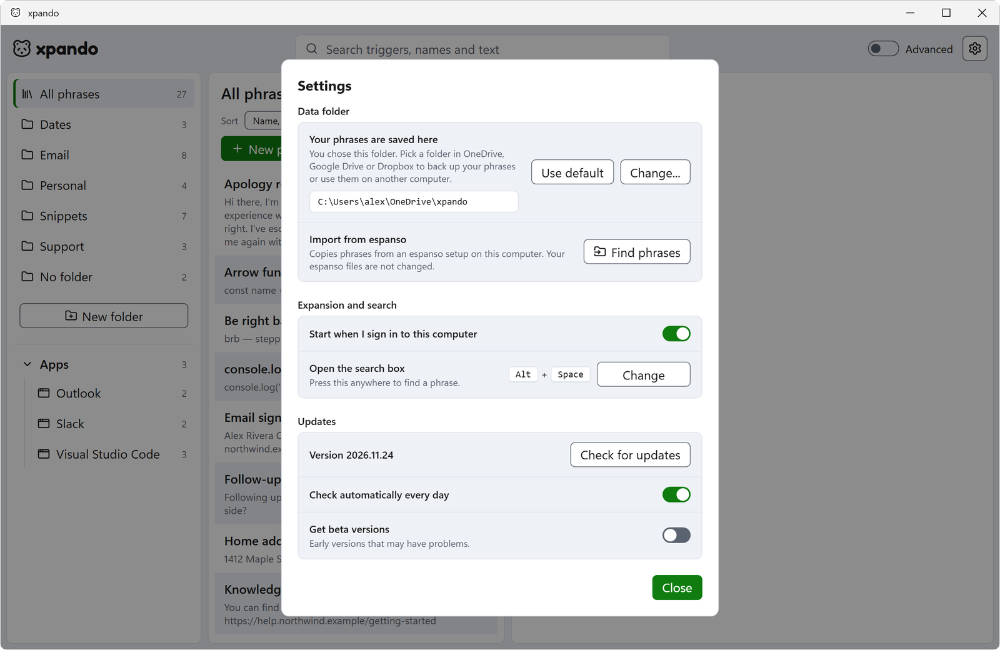

# Settings and Data Folder

Open **Settings** with the gear button at the top right of the xpando window. Settings has three groups: **Data folder**, **Expansion and search** and **Updates**.

## Your data folder

xpando keeps your phrases in its **own folder**. You do not have to set anything up. The first time xpando starts, it creates the folder for you.

### Where it is

| System | Default folder |
|---|---|
| Windows | `%APPDATA%\xpando` (for example `C:\Users\you\AppData\Roaming\xpando`) |
| macOS | `~/Library/Application Support/xpando` |
| Linux | `$XDG_CONFIG_HOME/xpando`, or `~/.config/xpando` |

**Settings** shows the folder under **Your phrases are saved here**. In [Advanced Mode](Advanced-Mode), the status bar shows it too.

### What is inside

* `match`: your phrase files. These are plain YAML files.
* `config`: settings for the engine, including which programs some of your phrase files work in, and `default.yml`, which holds the search shortcut.
* `xpando-folders.txt`: the names of the folders you made, so that empty ones are kept.
* `.bak` files: a copy of a file from before xpando first changed it.

xpando's engine is started with this folder, so it never reads or writes the folder of a separate espanso install. The choice of data folder itself is remembered in a small `settings.yml` in xpando's own settings location, kept apart from your phrases so it does not travel with them.

### Use another folder (OneDrive, Google Drive, Dropbox)

A folder in a sync service backs up your phrases and lets you use them on more than one computer.

1. In **Settings**, next to **Your phrases are saved here**, click **Change...**.
2. Click **Browse...** to pick a folder, or type its full path. xpando checks it and tells you if it cannot be used. It must be a folder you can write to. If it does not exist yet, xpando can create it (only the last part of the path).
3. Click **Next**. xpando asks **Copy your existing phrases to ...?**
   * **Copy my phrases** copies everything from the old folder to the new one. Nothing is moved: the old folder stays as it is, and files that already exist in the new folder are kept, not replaced.
   * **Start empty** switches without copying. If the new folder already has phrases, the button says **Just use this folder** and xpando uses them.
4. xpando shows what was done. If any file cannot be copied, it lists them and **keeps using the old folder**, so you never end up with half of your phrases in each place.

**Use default** (shown when you use a custom folder) switches back to the default folder. The folder you leave is never deleted.

### If the folder cannot be reached

A synced folder can be missing when you are signed out, offline, or a drive is not connected. xpando then shows a warning at the top of the window: **xpando cannot reach your data folder.** It does not switch to another folder behind your back, and it does not create the missing folder.

Fix the problem (sign in, reconnect), then click **Try again**. Or click **Settings** to choose another folder.

### Changes made outside xpando

When you come back to the xpando window, it reads the folder again, so changes from a sync service or from editing a file by hand show up. If you are in the middle of editing a phrase, xpando waits. Saving always checks first that the file did not change, and offers **Reload** if it did.

### Sync conflict copies

If your sync service leaves a "conflicted copy" next to a file, xpando shows a banner listing those files and which file each seems to copy. See [Sync Tips](Sync-Tips).

## Import from espanso

**Find phrases** (under **Import from espanso**) looks for an espanso setup on this computer and offers to copy it. See [Migrating from espanso](Migrating-from-espanso). If none is found, a note says "No espanso phrases were found on this computer."

## Expansion and search

* **Expansion is off** appears only when the engine is not running, with a **Turn on** button. If xpando cannot start it, the message says why. See [Troubleshooting](Troubleshooting).
* **Start when I sign in to this computer**: when on, xpando starts its engine in the background each time you sign in, without opening a window. Your phrases then work without you opening xpando. On Windows this adds a start entry for your user. On macOS and Linux it adds a login item.
* **Open the search box**: the shortcut that opens the search box from any program (**Alt+Space** unless you change it). See [Search](Search).

When you open the xpando window, it starts the engine for you unless you turned expansion off on purpose.

## Updates

**Check for updates**, **Check automatically every day** and **Get beta versions**. See [Updates](Updates).

## Back up your phrases

Your phrases are ordinary files, so backing up is easy: copy the data folder (or keep it in a synced folder). Before you try something risky, copy the `match` folder somewhere safe.

---

Related pages: [Sync Tips](Sync-Tips) | [Migrating from espanso](Migrating-from-espanso) | [Updates](Updates) | [Search](Search) | [Troubleshooting](Troubleshooting)
