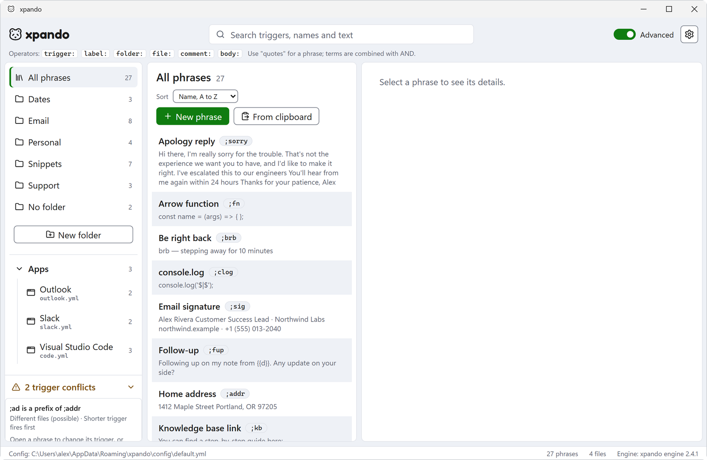

# Trigger Conflicts

A **trigger conflict** is when two triggers get in each other's way. xpando finds them for you, so a phrase does not expand the wrong way.

## Two kinds of conflict

**1. The same trigger twice.** Two phrases use the same trigger, for example `;sig`. xpando shows "`;sig` is defined 2 times". Only one of them can win.

**2. A trigger that is the start of another one.** Say you have `:ad` and `:addr`. When you type `:addr`, the engine expands `:ad` as soon as you have typed those three characters. Then `dr` is left over. xpando shows ":ad is a prefix of :addr".

Regex triggers are not checked.

## How sure is xpando?

Each conflict has a note:

* **Same file**: both phrases are always active together. This is a definite problem.
* **Different files (possible)**: the phrases are in different files. If those files are limited to different programs (see [Folders and Apps](Folders-and-Apps)), the two phrases may never be active at the same time, so this may be on purpose.
* For a prefix conflict: **Shorter trigger fires first**, or **Lower risk: word option on the shorter trigger**. The second means the shorter phrase has **Only expand when I type it as a whole word** or **Only expand at the end of a word** set. Then it only fires when a space or punctuation follows, so typing the longer trigger (whose next character is a letter or digit) does not set it off.

## See the conflicts

Conflicts are listed in [Advanced Mode](Advanced-Mode). With Advanced on and at least one conflict, a button at the bottom of the left pane shows "N trigger conflicts". Click it to open the list.

Each conflict shows its phrases with their trigger, file and any word option. Click a phrase to jump to it.

## Fix a conflict

Pick the way that fits:

1. **Change a trigger.** Click the phrase, click **Edit** and type a different trigger. For a prefix conflict, make the triggers different enough that one does not start the other.
2. **Add a word option** to the shorter phrase: tick **Only expand when I type it as a whole word** in its form. This lowers the risk when the longer trigger continues with a letter or digit.
3. **Delete the copy you do not need.** Next to each phrase in the list there is a **Delete** button. xpando then asks again with **Delete** and **Keep**. Deleting removes that phrase.

xpando never changes or deletes phrases without your click.

## Warnings while you edit

You do not need Advanced for this part. When you edit a phrase:

* A trigger already used by another phrase **in the same file** stops you from saving: "The trigger ... is already used by another phrase in this file."
* A trigger that is also used in a **different file** gives a warning, not an error: "... is also used in ... espanso may expand either one."

---

Related pages: [Writing Phrases](Writing-Phrases) | [Advanced Mode](Advanced-Mode) | [Folders and Apps](Folders-and-Apps) | [Troubleshooting](Troubleshooting)
