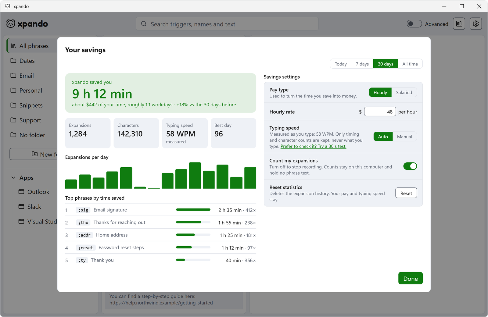

# Your Savings

**Your savings** shows how much typing xpando has done for you, as time and as money. Click the chart icon in the header (next to the gear) to open it.

*The numbers on this page are sample data.*

## What you see

* **The big number** is the typing time saved in the period you pick: **Today**, **7 days**, **30 days** or **All time**. Under it xpando shows what that time was worth and, for 7 and 30 days, how it compares with the period before.
* **Four numbers:** how many times a phrase was typed, how many characters that was, your typing speed, and your busiest day.
* **Expansions per day** is a chart of the last 14 days.
* **Top phrases by time saved** ranks the five phrases that saved you the most time, with the number of times each was used.

## How it is worked out

When a phrase is typed, xpando counts the characters it inserted and subtracts the trigger you typed yourself. Five characters make a word, so:

> time saved = (characters inserted - trigger length) / 5 / your words per minute

Money is the time saved multiplied by your hourly rate.

## Pay

Under **Savings settings**, choose how xpando works out what your time is worth:

* **Hourly:** enter your rate per hour.
* **Salaried:** enter your yearly pay and the hours you work each week. xpando divides by 52 weeks and shows the hourly rate it worked out.

If you enter nothing, xpando shows the time saved and leaves the money out. Money is shown in dollars.

## Typing speed

* **Auto** (the default) needs nothing from you. While you type, xpando times the gaps between key presses and keeps a running average. Until it has seen about 1,000 characters it assumes 40 words per minute and says the speed is still being estimated.
* **Manual** lets you type your own number.
* **Prefer to check it? Try a 30 s test** opens a short typing test with a passage from *A Scandal in Bohemia* by Arthur Conan Doyle. The clock starts at your first key. When it ends, **Use this speed** saves the result as your manual speed. The test is optional.

How Auto stays light and private:

* It only notes the **time between** key presses and **how many** printable characters you typed. It never records which keys you pressed.
* A pause of more than two seconds ends a burst and is not counted, so thinking time does not slow your speed.
* Keys held down, and the keys xpando itself types when it expands a phrase, are ignored.
* It does a few additions per key press and writes one tiny file a minute.

## Where the numbers are kept

Everything stays on your computer. xpando keeps a short log, one line per expansion with the time, the number of characters and the trigger, plus the running typing totals. It never holds your phrase text or anything you typed. The files are in xpando's local app data folder (on Windows, `%LOCALAPPDATA%\app.xpando.desktop\engine\stats`), not in your data folder, so a sync service such as OneDrive is not touched every time you expand a phrase. Each computer keeps its own numbers.

* **Count my expansions** turns recording off and on. It takes effect straight away.
* **Reset statistics** deletes the expansion history after you confirm. Your pay and typing speed stay.

## Good to know

* Counting starts once the engine has restarted on a version that includes this feature. xpando restarts it when you update.
* Phrases started from the search box or a hotkey count in the totals, but are not listed in the top phrases because they have no trigger.
* The window stays one page without scrolling in a normal-sized xpando window. In a very short window it scrolls.

---

Related pages: [Settings and Data Folder](Settings-and-Data-Folder) | [The Phrase Manager](The-Phrase-Manager) | [Troubleshooting](Troubleshooting)
